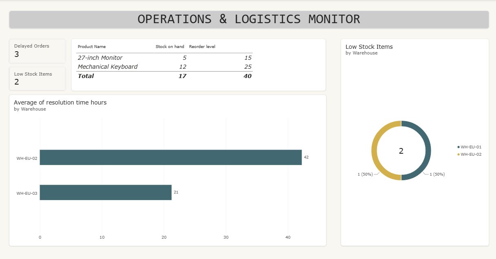

# 📊 Operations & Logistics Performance Monitor

## 📝 Business Overview & Problem
Logistics and e-commerce companies frequently face supply chain bottlenecks, stockouts, and SLA delivery delays. This project performs an end-to-end operational supply chain audit to identify stockout risks, delayed orders, and resolution time inefficiencies across regional distribution centers.

## 🛠️ Tech Stack & Architecture
- **SQL (SQLite):** Data extraction, auditing, and initial supply chain performance metrics.
- **Power BI Desktop:** Multi-table data modeling, visual design, and interactive filtering.
- **DAX:** Custom measures for critical inventory logic and SLA tracking.

## 📈 Dashboard Preview

## 🔍 Key Insights & Technical Deliverables
1. **Inventory & Stockout Audit (SQL & DAX):** Engineered the `Low Stock Items` metric using custom reorder threshold logic (`stock_on_hand <= reorder_level`), flagging critical items in specific warehouse locations (`WH-EU-01`, `WH-EU-02`).
2. **SLA & Incident Tracking:** Identified delayed orders and calculated average resolution times by warehouse to highlight operational bottlenecks.
3. **Data Modeling & Cardinality:** Built a 3-table relational schema (`orders`, `inventory_logs`, `incidents_slas`) enforcing single cross-filter direction to eliminate circular dependencies and metric duplication.

---
*Developed as a Data Analytics portfolio project focusing on Logistics & Supply Chain Operations.*